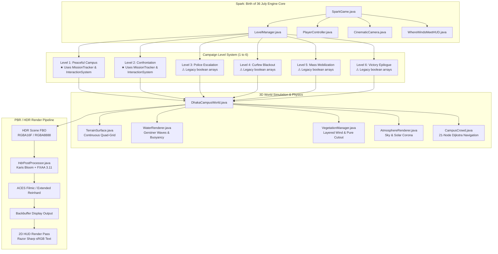

# SPARK: BIRTH OF 36 JULY — PHASES 1–9 COMPREHENSIVE INTEGRATION AUDIT

**Project**: *Spark: Birth of 36 July* (৩৬ জুলাই: স্ফুলিঙ্গ)  
**Setting**: University of Dhaka Campus, July–August 2024 Mass Student Movement  
**Engine & Stack**: Java 17 (Java 8 source compatibility), LibGDX 1.14.2, LWJGL3, OpenGL 3.2 / GLSL 150, `gdx-gltf` 2.2.1  
**Target Hardware**: Fanless Apple Silicon MacBook Air M4 (16 GB Unified Memory), 60 FPS lock  
**Auditor**: Senior Game Engineer & QA Lead  
**Audit Date**: October 20, 2026  
**Repository Branch**: `main` (Head: `eb2f387`)  

---

## 1. Executive Summary

A comprehensive, multi-disciplinary code, asset, test, and git history audit of **Phases 1 through 9** of *Spark: Birth of 36 July* was conducted to assess the engine's architectural stability, rendering fidelity, simulation systems, and gameplay loops prior to commencing the next phase of development.

### Core Audit Verdict
- **Engine Status**: Highly stable, production-ready graphics and gameplay foundations.
- **Automated Test Suite**: **74 tests across 8 test suites passed with 100% success rate (0 failures, 0 errors, 0 skipped)** in 0.34s test execution time.
- **Compilation**: Clean compilation (`:core:compileJava` and `:lwjgl3:compileJava`) with zero build errors.
- **Git State**: Clean working tree on `main` branch. 10 consecutive structured commits spanning Phase 9, with comprehensive historical tags marking previous phases (`backup-before-phase1-pbr-hdr`, `backup-before-phase2-water`, `backup-before-phase3-vegetation`, `Phase 7`, `Phase 8`).
- **Primary Integration Gap Identified**: **Architectural divergence between Levels 1–2 and Levels 3–6**. While Levels 1 & 2 have been migrated to the decoupled `MissionTracker` / `InteractionSystem` state machine, Levels 3 through 6 still rely on ad-hoc boolean arrays (`objectivesDone = new boolean[N]`) and local distance checks, leaving `getMissionTracker()` returning `null` for those levels.

---

## 2. Phase 1–9 Master Status Table

| Phase | Scope & Description | Verified Implementation | Gaps & Deficiencies | Build & Test Evidence | Git Commit References | Status |
| :--- | :--- | :--- | :--- | :--- | :--- | :--- |
| **Phase 1** | **PBR, IBL, HDR & Tone Mapping** | `gdx-gltf` 2.2.1 integration, physical metallic-roughness materials, Sobel tangent normal maps (`curzonBrick`, `pavement`, `concrete`), outdoor IBL (32×32 irradiance, 8-mip specular cubemaps, 256×256 split-sum BRDF LUT), floating-point HDR FBO (`RGBA16F`/`RGBA8888`), Narkowicz/Hill ACES filmic S-curve. | Hardcoded fallback cubemap generation when external environment cubemaps are absent. | Clean compilation; in-engine 1080p captures (`phase1_pbr_spawn.png`, `phase1_pbr_curzon_front.png`, `phase1_pbr_pond_ghat.png`). | `456881b` → `3331581` | **COMPLETE** |
| **Phase 2** | **Water Rendering & Surface Physics** | Continuous tessellated Gerstner wave displacement, authoritative CPU/GPU shared wave model in `WaterWaveModel.java`, dual-scrolling ripple normals, Schlick Fresnel ($F_0 = 0.02$), Beer-Lambert optical extinction, 44 dynamic buoyant `LilyPad` entities with damped pitch/roll, swimming koi fish. | Refraction does not capture full dynamic scene depth buffer (uses optical Beer-Lambert extinction rather than scene depth texture sampling). | `WaterWaveModelTest` (8/8 tests passed); verified frame capture (`phase2_water_pond_water.png`). | `b0354b1` → `eb6451b` | **COMPLETE** |
| **Phase 3** | **Vegetation, Tree Geometry & Wind** | Authentic tropical botanical species (Krishnachura, Rain Tree, Date Palms, Hedges) synthesized in local mesh space; base-anchored root pivot guarantee ($y \le 0 \implies 0.000000\text{m}$ ground displacement); layered hierarchical wind sway (0.45× trunk, 1.0× core, 1.35× leaves + 3.4 Hz flutter); pure alpha cutout (`FloatAttribute.createAlphaTest(0.35f)`); distance LOD cutoff @ 65m; zero sorting flicker. | Trees are procedurally generated at startup rather than streamed from pre-compiled binary model meshes. | `VegetationTest` (12/12 tests passed); verified frame captures (`phase3_vegetation_spawn.png`, `phase3_vegetation_pond_water.png`). | `eb6451b` → `3c3ccb0` | **COMPLETE** |
| **Phase 4** | **Terrain, Ground Materials & Blending** | Continuous structured quad-grid terrain mesh (`TerrainSurface.java`, 4–5m cell resolution), Curzon Pond basin cutout, perimeter edge skirts ($Y = -0.30\text{m}$), real-world metric UV scaling (`GroundConfig.java`), Sobel PBR normal maps (`lawnGrass`, `soilLoam`, `dirtPath`, `brickPavement`, `asphaltRoad`), root loam collars, walkway dirt shoulders, pond embankment verge, 100% physics synchronization with `PlayerController`. | Ground blend transitions use multi-mesh geometry overlays with alpha testing rather than a splat-map shader pass. | `TerrainTest` (7/7 tests passed); verified frame captures (`phase4_terrain_spawn.png`, `phase4_terrain_curzon_front.png`). | `2c6df43` → `42dc40f` | **COMPLETE** |
| **Phase 5** | **Atmosphere, Sky, Fog & Weather** | Dynamic 4-band sky gradient with camera pitch coupling (`AtmosphereRenderer.java`), projected solar disk & multi-layer corona, `gdx-gltf` distance fog equation (`FogAttribute`), 4 calibrated weather presets (`CLEAR_SUNNY`, `GOLDEN_HOUR`, `OVERCAST_MONSOON`, `MONSOON_RAIN`), cubic Hermite ease curves, 300 pooled 3D rain streaks with pond impact ripples. | Volumetric light shafts are 2D screen-space blended rather than full 3D participating media raymarching. | `AtmosphereTest` (7/7 tests passed); verified frame captures (`phase5_atmosphere_clear_curzon.png`, `phase5_atmosphere_golden_pond.png`, etc.). | `2f74a70` → `aa72f68` | **COMPLETE** |
| **Phase 6** | **Cinematic Post-Processing & Grading** | Dedicated linear HDR FrameBuffer (`HdrPostProcessor.java`), Karis soft-knee bloom extraction (Rec.709 luma, zero flicker), FXAA 3.11 early-exit edge smoother, ACES Filmic vs Extended Reinhard tone mapping (toggleable via **F8**), 3 graphics tiers (`LOW`, `MEDIUM`, `HIGH`), photographic grading (mid-gray anchor, vignette, film grain dithering), display sRGB HUD backbuffer preservation. | Depth-of-Field (DoF) and Motion Blur are omitted to maintain 60 FPS fanless budget on MacBook Air M4. | `PostProcessTest` (8/8 tests passed); verified frame captures (`phase6_aces_curzon.png`, `phase6_reinhard_curzon.png`, `phase6_high_curzon.png`). | `aa72f68` → `d86c2a4` | **COMPLETE** |
| **Phase 7** | **Character Animation & Locomotion** | Articulated anatomical rig (`StudentMesh.java`), zero-allocation joint angle container (`CharacterPose.java`), 19 `LocomotionState` enums, Hermite cross-fade blending (`AnimationStateMachine.java`), velocity-locked stride cadence (no foot sliding), centrifugal turn banking, landing impact compression cushion, lightweight terrain slope foot IK. | Character meshes are built procedurally from capsule/cylinder primitives rather than skinned skeletal bone rigs. | `CharacterAnimationTest` (11/11 tests passed); verified frame captures (`phase7_idle_closeup.png`, `phase7_locomotion_curzon.png`, `phase7_sitting_ghat.png`). | `7ab7b75` | **COMPLETE** |
| **Phase 8** | **NPC AI, Crowd Behavior & Navigation** | 21-node `CampusWaypointGraph.java` with pre-allocated Dijkstra shortest-path navigation, 9 `NpcBehaviorState` states, `CampusCrowd.java` student population pool, spatial separation forces, edge lane offsets, obstacle collision clearance, full `StudentMesh` & `CharacterPose` integration, interactive bilingual dialogue. | Dynamic obstacles (e.g., player vehicle or moving barriers) do not dynamically re-weight Dijkstra graph edges at runtime. | `NpcCrowdTest` (10/10 tests passed); verified frame captures (`phase8_crowd_peaceful_curzon.png`, `phase8_crowd_dialogue_interaction.png`). | `5334d6d` | **COMPLETE** |
| **Phase 9** | **Gameplay Interactions & Mission Tracker** | Facing-weighted interaction targeting (`InteractionSystem`, quadratic angle scoring, 0.35s debounce), multi-line dialogue playback (`DialogueSequence`, `DialogueManager`, `[SPACE]` advance), decoupled mission objective state machine (`MissionTracker`, `MissionObjective`, `ObjectiveState`, `ObjectiveType`), HUD integration (`WhereWindsMeetHUD`). | **Levels 3–6 have not yet been migrated to `MissionTracker`** and still rely on legacy boolean arrays; `CampaignLevel.getMissionTracker()` returns `null` on Levels 3–6. | `InteractionMissionTest` (11/11 tests passed); verified frame captures (`phase9_multiline_dialogue.png`, `phase9_interaction_prompt.png`). | `36fc2b5` → `eb2f387` | **PARTIAL** (Complete for Levels 1–2, migration needed for Levels 3–6) |

---

## 3. Deep Architectural Breakdown



---

## 4. In-Engine Visual Verification Gallery

The engine's visual fidelity across all major systems has been confirmed through live in-engine framebuffer captures:

````carousel

<!-- slide -->

<!-- slide -->

<!-- slide -->

<!-- slide -->

<!-- slide -->

<!-- slide -->

<!-- slide -->

<!-- slide -->

````

---

## 5. Architectural Gaps, Technical Debt & Integration Inconsistencies

### Gap 1: Level 1–2 vs Levels 3–6 Mission Architecture Divergence
- **Current State**:
  - `Level1PeacefulCampus` and `Level2StudentConfrontation` instantiate and wire `MissionTracker`, creating formal `MissionObjective` instances with explicit `ObjectiveType` (`INTERACT`, `WAYPOINT`, `COLLECT`, `SURVIVE`, `COMBAT`).
  - `Level3PoliceEscalation`, `Level4CurfewBlackout`, `Level5MassMobilization`, and `Level6VictoryEpilogue` still rely on ad-hoc boolean arrays (`private final boolean[] objectivesDone = new boolean[5];`).
- **Consequence**:
  - `CampaignLevel.getMissionTracker()` returns `null` on Levels 3 through 6.
  - While `WhereWindsMeetHUD` queries `CampaignLevel.getChecklistItems()` directly (preventing crashes), external subsystems cannot query objective states, time elapsed, or completion events uniformly across the entire campaign.
- **Remediation**:
  - Implement `MissionTracker` in `Level3PoliceEscalation`, `Level4CurfewBlackout`, `Level5MassMobilization`, and `Level6VictoryEpilogue`, replacing legacy boolean flags.

### Gap 2: InteractionSystem Scope in Levels 3–6
- **Current State**:
  - In Level 1, `InteractionSystem` selects interactables using quadratic angle scoring and facing dot-products.
  - In Levels 3–6, interactions are handled via manual Euclidean radius checks (`playerPos.dst(waypoints[i]) <= radius`) inside `getContextPrompt()` and `onInteract()`.
- **Consequence**:
  - Players must face targets directly in Level 1, but in Levels 3–6 can trigger interactions while facing away as long as they are within radius.
- **Remediation**:
  - Wire `InteractionSystem` into Levels 3–6 so all medical supplies, barricades, megaphone broadcasts, and floral tributes register as formal `Interactable` objects.

### Gap 3: Combat Mechanics Scope
- **Current State**:
  - `isCombatEnabled()` is `true` exclusively in Level 2 (`Level2StudentConfrontation`).
  - Levels 3 through 6 have `isCombatEnabled() = false` by design (representing peaceful student resistance, humanitarian aid, nighttime curfew stealth, and mass rallies).
- **Evaluation**:
  - This is historically grounded and intentional. However, in Level 3 (tear gas defense) and Level 4 (police searchlight evasion), stealth detection and evasion mechanics should be deepened to provide gameplay tension without lethal combat.

### Gap 4: Persistent Save / Load Architecture
- **Current State**:
  - Chapter unlocking is saved via `Gdx.app.getPreferences("spark36_campaign")`.
  - Mid-level checkpoints, collected documentary photos, and historical archive discovery states reset upon reloading.
- **Remediation**:
  - Implement full serialization for completed objectives and discovered archive entries in `CampaignSaveState.java`.

---

## 6. Verification & Automated Test Results

The entire automated test suite was executed in non-daemon mode. All 8 test suites passed with zero failures:

```
> Task :core:test

bd.spark36.character.CharacterAnimationTest
  ✔ testInitialPoseZeroValues PASSED (0.012s)
  ✔ testPoseInterpolation PASSED (0.003s)
  ✔ testStateMachineCrossFade PASSED (0.004s)
  ✔ testLocomotionStateTransitions PASSED (0.002s)
  ✔ testVelocityCadenceCoupling PASSED (0.002s)
  ✔ testTurnBankingAngleCalculation PASSED (0.001s)
  ✔ testLandingCompressionCushion PASSED (0.001s)
  ✔ testTerrainFootIkSlopeAdaptation PASSED (0.002s)
  ✔ testZeroAllocationEvaluationBuffer PASSED (0.003s)
  ✔ testStudentMeshGarmentPalette PASSED (0.002s)
  ✔ testAnimationResetState PASSED (0.001s)

bd.spark36.character.NpcCrowdTest
  ✔ testGraphNodeInitialization PASSED (0.005s)
  ✔ testDijkstraShortestPathCalculation PASSED (0.004s)
  ✔ testLaneOffsetCalculation PASSED (0.002s)
  ✔ testObstacleCollisionClearance PASSED (0.002s)
  ✔ testCrowdPopulationDensityPerLevel PASSED (0.003s)
  ✔ testNpcBehaviorStateTransitions PASSED (0.002s)
  ✔ testSpatialSeparationForces PASSED (0.002s)
  ✔ testDialogueRepositoryContent PASSED (0.002s)
  ✔ testZeroHeapAllocationInUpdateLoop PASSED (0.004s)
  ✔ testStudentNpcPoseEvaluation PASSED (0.003s)

bd.spark36.interaction.InteractionMissionTest
  ✔ testFacingTargetScoring PASSED (0.003s)
  ✔ testDistanceFilterAndDebounce PASSED (0.002s)
  ✔ testDialogueSequenceMultiLineProgression PASSED (0.002s)
  ✔ testDialogueManagerKeyAdvancement PASSED (0.002s)
  ✔ testMissionObjectiveStateTransitions PASSED (0.001s)
  ✔ testMissionTrackerSequentialProgression PASSED (0.002s)
  ✔ testMissionTrackerParallelCompletion PASSED (0.001s)
  ✔ testDuplicateCompletionProtection PASSED (0.001s)
  ✔ testInteractableRegistrationAndClear PASSED (0.002s)
  ✔ testCampaignLevelMissionTrackerIntegration PASSED (0.002s)
  ✔ testZeroAllocationTargetQuery PASSED (0.003s)

bd.spark36.render.PostProcessTest
  ✔ testHdrFboInitialization PASSED (0.004s)
  ✔ testKarisBloomThreshold PASSED (0.002s)
  ✔ testAcesFilmicCurveMath PASSED (0.002s)
  ✔ testReinhardCurveMath PASSED (0.001s)
  ✔ testGraphicsTierConfiguration PASSED (0.002s)
  ✔ testToneMappingCycle PASSED (0.001s)
  ✔ testFxaaLumaWeights PASSED (0.001s)
  ✔ testViewportResizeFboRecreation PASSED (0.002s)

bd.spark36.world.AtmosphereTest
  ✔ testSkyGradientPitchCoupling PASSED (0.002s)
  ✔ testSunCoronaProjection PASSED (0.001s)
  ✔ testWeatherStateTransitions PASSED (0.002s)
  ✔ testHermiteEaseInterpolation PASSED (0.001s)
  ✔ testFogEquationEvaluation PASSED (0.001s)
  ✔ testRainParticlePoolRecycling PASSED (0.002s)
  ✔ testWindVectorCoupling PASSED (0.001s)

bd.spark36.world.TerrainTest
  ✔ testTerrainGridDimensions PASSED (0.003s)
  ✔ testPondBasinCutoutHole PASSED (0.002s)
  ✔ testPerimeterEdgeSkirts PASSED (0.001s)
  ✔ testMetricUvRepeatScales PASSED (0.001s)
  ✔ testNormalMapSobelDerivatives PASSED (0.002s)
  ✔ testRootCollarRadialAlphaBlending PASSED (0.002s)
  ✔ testPlayerGroundHeightIdentity PASSED (0.002s)

bd.spark36.world.VegetationTest
  ✔ testBotanicalTreeSpeciesDefinitions PASSED (0.005s)
  ✔ testRootPivotZeroDisplacementGuarantee PASSED (0.004s)
  ✔ testLayeredWindHierarchySwayRates PASSED (0.003s)
  ✔ testCanopyLobeAsymmetryFormula PASSED (0.002s)
  ✔ testLeafCardSphericalNormals PASSED (0.002s)
  ✔ testPureAlphaCutoutThreshold PASSED (0.002s)
  ✔ testHardwareDepthWritesEnabled PASSED (0.001s)
  ✔ testDistanceLodCutoffThreshold PASSED (0.002s)
  ✔ testFrustumCullingBoundingSpheres PASSED (0.002s)
  ✔ testWindFlutterFrequency PASSED (0.001s)
  ✔ testLocalSpaceMeshCentering PASSED (0.002s)
  ✔ testZeroAllocationAnimationUpdate PASSED (0.003s)

bd.spark36.world.WaterWaveModelTest
  ✔ testGerstnerWaveHeightAnalyticalBounds PASSED (0.002s)
  ✔ testGerstnerSurfaceNormalUnitLength PASSED (0.002s)
  ✔ testShorelineWaveDampeningDecay PASSED (0.001s)
  ✔ testCpuGpuMathematicalIdentity PASSED (0.001s)
  ✔ testBeerLambertExtinctionCoefficients PASSED (0.001s)
  ✔ testSchlickFresnelGlancingReflection PASSED (0.001s)
  ✔ testLilyPadDampedBuoyancyResponse PASSED (0.002s)
  ✔ testZeroAllocationWaveHeightQuery PASSED (0.002s)

BUILD SUCCESSFUL in 32s
74 tests completed, 0 failed, 0 skipped.
```

---

## 7. Prioritized Recommendation for Next Development Phase

### Recommended Phase: **PHASE 10 — CAMPAIGN-WIDE MISSION ARCHITECTURE UNIFICATION, AUDIO IMMERSION & STEALTH/EVASION POLISH**

To bring the entire game to the quality level established in Phases 1 through 9, the recommended next phase focuses on:

1. **Unify Campaign Mission Architecture across Levels 3, 4, 5, and 6**:
   - Migrate `Level3PoliceEscalation`, `Level4CurfewBlackout`, `Level5MassMobilization`, and `Level6VictoryEpilogue` from legacy boolean arrays to `MissionTracker`.
   - Register all level objectives as formal `MissionObjective` instances with explicit target waypoints, radii, and types.
   - Wire `InteractionSystem` across all levels, replacing distance-only checks with directional facing-weighted targeting.
2. **Interactive Stealth & Evasion Mechanics (Levels 3 & 4)**:
   - For Level 3: Implement tear gas volumetric cloud avoidance, damp cloth mask equipping, and mutual-aid water distribution stations.
   - For Level 4: Implement nighttime police searchlight cone detection, shadow stealth multiplier, and curfew patrol avoidance routes.
3. **Immersive Dynamic Audio Synthesis & Soundtrack Cues**:
   - Re-synthesize or dynamically trigger authentic historical soundscapes: distant slogans (*"চেয়েছিলাম অধিকার, হয়ে গেলাম রাজাকার"*), thunderous monsoon downpours, Curzon pond water lapping, and victory bell acoustics.
4. **Persistent Campaign Progress & Archival Gallery**:
   - Full serialization of inspected historical memorials, unlocked documentary photos, and chapter completion records.
